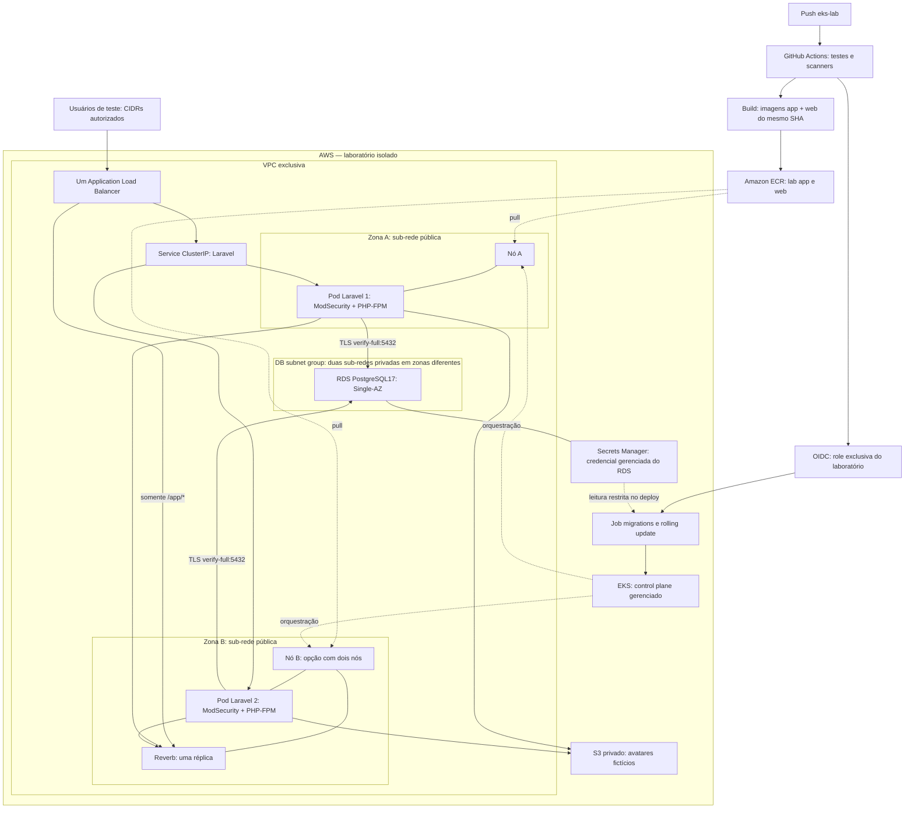

# Arquitetura e apresentação — ManaLeague EKS Lab com RDS

## Limite de segurança

Este laboratório é descartável e independente da produção. Produção permanece na `main`, EC2 + Docker Compose, domínio e PostgreSQL atuais. Não se copiam bancos, arquivos privados, credenciais, volumes ou Terraform state de produção. Não há peering, acesso SSH ou alteração de DNS da produção. Recursos do repositório são configuração; a existência dos arquivos não comprova que algo foi criado na AWS.

O laboratório usa o identificador `manaleague-eks-lab`, namespace de mesmo nome e tags `Project=manaleague-eks-lab` / `Environment=eks-lab`. **Nunca limpar recursos pela tag `academic`: o Terraform antigo da produção também usa essa tag.** Identificar o alvo por state, conta, região e IDs exatos.

## Decisões

- EKS gerenciado convencional, versão em suporte padrão; sem Auto Mode/Fargate.
- VPC exclusiva, duas sub-redes públicas para ALB/nós e duas privadas para o DB subnet group do RDS, em duas zonas. Internet Gateway apenas nas públicas, sem NAT Gateway. Nós recebem IPv4 para saída, mas sem SSH nem entrada irrestrita. API do EKS privada e pública com CIDRs autorizados explícitos. Não usar `0.0.0.0/0`.
- Um nó `t3.medium` como opção econômica; dois nós em zonas diferentes para demonstração distribuída. Dois Pods em um único nó não protegem contra perda do nó.
- ALB internet-facing exclusivo, restrito aos IPs de demonstração, gerenciado pelo AWS Load Balancer Controller. Ingress usa targets IP; Service da aplicação é ClusterIP, não um segundo LoadBalancer.
- Duas réplicas HTTP: cada Pod contém Nginx/ModSecurity/OWASP CRS + PHP-FPM. A imagem web contém os assets do mesmo commit da imagem PHP.
- **RDS PostgreSQL17 é obrigatório**: db.t4g.micro, Single-AZ,20GB gp3 criptografado, banco privado em DB subnet group de duas zonas. SG5432 permite somente os nós EKS. Single-AZ não é HA/Multi-AZ. Não há PostgreSQL StatefulSet ou PVC de banco no EKS. O EBS CSI continua configurado, mas não armazena RDS.
- Senha gerenciada pelo RDS/Secrets Manager, sem texto no tfvars/state. Deploy valida identidade/VPC/endpoint e lê só o segredo exato do lab; não há GitHub Secret DB_PASSWORD. Aplicação conecta com TLS verify-full e CA oficial. A cópia do segredo no Kubernetes é atualizada no deploy, não sincronizada continuamente; após rotação padrão de7dias, reexecutar o deploy. A credencial master simplifica o lab; separar usuário de aplicação/migrations é evolução de menor privilégio.
- Sessões/cache/locks no PostgreSQL. APP_KEY estável, exclusiva e igual entre réplicas. Não usar sessions ou cache locais para dados compartilhados.
- Avatares no S3 privado do lab, com IRSA dedicada e URLs assinadas. Nenhum bucket de produção. O ensaio local pode usar disco local: isso não comprova a integração real com S3.
- Reverb separado, uma réplica. Só `/app/*` passa pela borda; `/apps/*` não é API pública. Scaling de Reverb requer outra implementação; aumentar réplicas HTTP não exige aumentar Reverb.
- Job único de migrations antes do rollout, sem importar SQLite legado e sem migrations automáticas em cada réplica. CronJobs do lab não chamam tarefas da produção.
- Modo inicial HTTP pelo hostname do ALB e acesso restrito, apenas dados fictícios. HTTP não oferece confidencialidade. HTTPS requer hostname/certificado separados e decisão explícita; não altera o domínio principal automaticamente.

## Diagrama

A localização dos auxiliares é ilustrativa. Com um nó, os Pods ficam no mesmo nó; as duas zonas continuam necessárias para o ALB. Não afirmar tolerância à falha de zona do banco.

## Identidades e pipeline

O operador de infraestrutura provisiona a AWS com credenciais próprias aprovadas. A role OIDC de deploy não provisiona VPC/EKS nem modifica endpoint, DNS ou produção. Ela publica somente nos ECRs do laboratório, consulta o cluster e a instância RDS exatos e lê somente a credencial gerenciada desse banco. Não modifica RDS. O runner não precisa da porta5432 privada: migrations/seed rodam em Jobs dentro da VPC. O acesso Kubernetes é limitado ao namespace pelo grupo de deploy. Controllers e aplicação possuem roles IRSA separadas. O fornecedor OIDC GitHub pode ser compartilhado pela conta; não duplicá-lo nem apagá-lo na limpeza do laboratório.

O GitHub Environment `eks-lab` deve aceitar apenas a branch `eks-lab`. `production` deve aceitar apenas `main` como defesa adicional. Claims OIDC podem ter IDs imutáveis: conferir o subject exato usado pelo repositório antes de provisionar a trust policy. Não usar wildcard para todas as branches/environments.

Um runner que acessa a API restrita precisa de saída de rede estável autorizada ou conectividade privada. Não instalar runner no servidor de produção nem ampliar a API para o mundo para contornar esse requisito. Tratar runners self-hosted como infraestrutura confiável e dedicada; não executar código não confiável de PR com segredos.

Não criar cluster a cada push. Provisionar e destruir são procedimentos separados do deploy. Sem infraestrutura, validações locais/CI continuam úteis, mas não comprovam EKS operacional.

## Custos estimados

Referência consultada em 16/11/2026: Norte da Virgínia, Linux On-Demand, sem créditos presumidos. EC2 t3.medium, RDS db.t4g.micro e gp3 RDS foram reconferidos via AWS Pricing GetProducts na preparação do primeiro plano real; valores e cálculo são evidências locais em `.local/`. Conferir novamente antes de criar recursos.

| Componente | Referência |
|---|---:|
| EKS em suporte padrão | US$ 0,10/h |
| t3.medium | US$ 0,0416/h por nó |
| ALB | US$ 0,0225/h |
| Consumo de ALB: hipótese de 1 LCU | US$ 0,008/h |
| IPv4 público | US$ 0,005/h/endereço |
| EBS gp3 base | US$ 0,08/GB-mês |
| ECR | US$ 0,10/GB-mês |
| RDS db.t4g.micro PostgreSQL Single-AZ | US$0,016/h |
| RDS gp3 (20GB) | US$0,115/GB-mês = US$2,30/mês |
| Secrets Manager (um segredo) | US$0,40/mês + chamadas API |

| Cenário | 8h | 24h | 30 dias (720h) |
|---|---:|---:|---:|
| Um nó EKS + RDS | US$1,67 | US$5,02 | US$150,73 |
| Dois nós EKS + RDS | US$2,07 | US$6,20 | US$185,88 |

Cálculo:20GB EBS por nó,20GB gp3 do RDS, um segredo, ECR total2GB, dois IPv4 do ALB + um por nó e hipótese de1LCU. RDS é privado, sem IPv4 público nem PVC de banco no EKS. Tarifas EBS dos nós e gp3 do RDS são diferentes. Não contratar LCU reservada: é uma estimativa de consumo, não mínimo garantido. Valores não são teto de cobrança. Excluem uso/requisições S3, chamadas Secrets Manager, backup/snapshot excedente, transferências entre zonas e internet, logs opcionais, recursos residuais, impostos e câmbio. RDS T4g opera em Unlimited e créditos excedentes podem custar US$0,075/vCPU-h; não presumir que estão incluídos. Uso maior do ALB ou mais endereços aumenta o total. Créditos e franquias são da conta e não estão presumidos disponíveis.

Desligar nós/zerar réplicas não elimina o control plane, ALB, RDS, EBS, ECR, segredo ou bucket. EKS em suporte estendido custa US$ 0,60/h só pelo cluster: conferir a janela de suporte antes de cada sessão. Configurar AWS Budgets com notificações reais e previstas; alertas podem atrasar e **não são bloqueio automático de gastos**. Não programar destruição indiscriminada por budget, pois a conta também contém produção.

Fontes oficiais:
- RDS PostgreSQL/CPU credits: https://aws.amazon.com/rds/postgresql/pricing/
- Catálogo de preços oficial consultado, região US East(N.Virginia): https://b0.p.awsstatic.com/pricing/2.0/meteredUnitMaps/rds/USD/current/rds-postgresql-ondemand.json
- Secrets Manager: https://aws.amazon.com/secrets-manager/pricing/
- Senha gerenciada/rotação: https://docs.aws.amazon.com/AmazonRDS/latest/UserGuide/rds-secrets-manager.html
- Subnets privadas RDS: https://docs.aws.amazon.com/AmazonRDS/latest/UserGuide/USER_VPC.WorkingWithRDSInstanceinaVPC.html
- TLS PostgreSQL: https://docs.aws.amazon.com/AmazonRDS/latest/UserGuide/PostgreSQL.Concepts.General.SSL.html
- EKS: https://aws.amazon.com/eks/pricing/
- EC2 T3: https://aws.amazon.com/ec2/instance-types/t3/
- ALB: https://aws.amazon.com/elasticloadbalancing/pricing/
- IPv4/NAT: https://aws.amazon.com/vpc/pricing/
- EBS: https://aws.amazon.com/ebs/general-purpose/
- ECR: https://aws.amazon.com/ecr/pricing/
- Rede EKS: https://docs.aws.amazon.com/eks/latest/userguide/network-reqs.html
- ALB EKS: https://docs.aws.amazon.com/eks/latest/userguide/alb-ingress.html
- OIDC: https://docs.github.com/en/actions/how-tos/secure-your-work/security-harden-deployments/oidc-in-aws
- Budgets: https://docs.aws.amazon.com/cost-management/latest/userguide/budgets-managing-costs.html

## Apresentação ao professor (8–10 minutos)

1. **Problema e isolamento:** mostrar arquitetura; explicar que o produto real continua em EC2 e o EKS só contém dados fictícios. Mostrar conta/região, nomes e namespace do laboratório sem revelar secrets.
2. **Infra como código:** mostrar VPC em duas zonas, EKS e managed nodes. Mostrar também RDS privado, criptografia, subnets/SG5432 e backup. Explicar economia sem NAT e Single-AZ versus Multi-AZ; não mostrar senha.
3. **Aplicação:** abrir URL do ALB a partir do IP autorizado, entrar na conta fictícia, mostrar torneio/placar e duas sessões para tempo real.
4. **Balanceamento:** mostrar duas réplicas Ready e os targets saudáveis. Executar repetidas requisições sem cache a `/up` e observar identidade do Pod quando exposta pelo lab. Não afirmar que alternância estrita a cada requisição é requisito do ALB.
5. **Escala:** aumentar réplicas HTTP de 2 para 3, observar rollout/targets e depois voltar a 2. Isso é escala manual; não chamar de HPA/autoscaling automático.
6. **Autorreparo:** remover somente um Pod HTTP do lab, observar o Deployment criar substituto, aguardar Ready e testar novamente. Remover Pod não prova falha de nó/AZ.
7. **Deploy:** fazer uma alteração acadêmica segura, commit/push pelo proprietário na `eks-lab`, mostrar GitHub Actions, SHA imutável no ECR, migration Job e rollout. Ações AWS só depois de autorização/provisionamento. Nenhum push é feito automaticamente pelo agente.
8. **Persistência:** gravar informação fictícia, recriar um Pod Laravel e confirmar que dados/sessão permanecem no RDS externo. Não existe Pod PostgreSQL no EKS; não apagar/reiniciar RDS para demonstrar recuperação de Pod. Explicar backup gerenciado e Single-AZ sem prometer failover.
9. **WAF e segurança:** uma requisição legítima passa; SQLi/XSS conhecidos são bloqueados; segredo/env, PostgreSQL e API interna do Reverb não estão públicos. Não usar scanner agressivo no domínio real.
10. **Custos e limpeza:** mostrar estimativa e plano de desmontagem; coletar evidências antes de excluir. Excluir ALB enquanto Controller funciona; parar workloads e depois excluir RDS/EKS/rede pelo state exclusivo. Defaults descartáveis sem snapshot final exigem confirmar perda dos dados fictícios. Revisar possíveis snapshots/backups residuais. Verificar resíduos no console e faturamento após sua atualização.

## Evidências e limites

Guardar screenshots do cluster/nós, Pods Ready, ALB healthy targets, ECR com SHA, execução da pipeline, recuperação de Pod e exclusão final. Registrar horários, conta/região e versão. Não capturar senhas, tokens ou kubeconfig.

Validação estática de Terraform/manifests não comprova permissões IAM em execução, capacidade/região AWS, criação do ALB/RDS, TLS/CA e credenciais reais do RDS, backups/restore, IRSA/S3 ou deploy remoto. Ensaios locais com Docker comprovam o runtime, não o control plane EKS. O relatório deve distinguir esses níveis.
